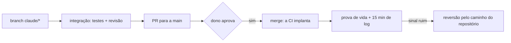

# Ambientes: o que o agente pode em cada um

Vale em qualquer lugar. O nome de cada ambiente, a branch que o alimenta e até onde o agente vai são do `fluxo`
da configuração (`CLAUDE.local.md` e o `AGENTS.md` do projeto), não daqui.

| Ambiente | Ler | Escrever | Implantar |
|---|---|---|---|
| dev (local, container) | sim | sim | sim |
| integração (homologação, staging) | sim | sim, pelo caminho do `fluxo` | a esteira, nunca à mão |
| produção | listar, descrever, consultar, `SELECT` | não | só o merge do PR aprovado pelo dono |

Reconhecer produção: perfil, conta, variável ou endereço com `prod`, `prd` ou `producao`; conta, região ou
endereço listado na linha `producao:` do `CLAUDE.local.md`. Sem sinal claro, é produção. Antes de cada chamada, diga
em uma linha o ambiente alvo. A trava de verdade é a credencial: produção se acessa com usuário só leitura.

## Produção com o agente (onde o dono liberou)

Projeto listado na linha `producao-liberada:` do `CLAUDE.local.md`. Lá a sessão leva a entrega até produção, assim:

1. Só pelo caminho que o repositório já tem: merge do PR aprovado (ou com os checks no lugar da aprovação, na seção
   seguinte), e a CI implanta. Nunca deploy à mão.
2. Antes do merge: integração verde com a entrega e a reversão ensaiada nela (o comando que desfaz vai no PR).
3. Depois do merge: deploy conferido pelo SHA; prova de vida (a tela ou o endpoint principal); erro e latência
   lidos por 15 minutos, com o comando e a saída na issue.
4. Sinal ruim (erro novo, 5xx, tela quebrada): reverta pelo caminho de reversão do repositório e avise na issue.
   Reverter é liberado; insistir não.
5. Dado de produção: só pelo caminho do app, com backup conferido antes; em massa, só com o sim do dono.
6. Nunca, mesmo liberada: migração que apaga coluna ou tabela, apagar dado, trocar segredo, infra fora do PR.

## Merge sem aprovação humana (onde o dono liberou)

Projeto marcado `(sem-aprovacao)` na linha `producao-liberada:` do `CLAUDE.local.md`. Lá a sessão mescla sem esperar
o dono aprovar, e o resto da seção anterior continua valendo:

1. Só onde a regra da branch de produção exige os checks no lugar da aprovação (suíte, build e a prova que o
   `AGENTS.md` do projeto pedir). Sem isso no repositório, vale a aprovação do dono.
2. Antes do merge: os checks verdes, cada critério da issue provado no PR e o conhecimento da entrega gravado.
3. Esperam o dono, mesmo assim: infraestrutura e permissão (IaC, IAM, a regra da branch, segredo), migração de dado
   e os caminhos que o `AGENTS.md` do projeto listar como sensíveis (por exemplo, o cálculo de dinheiro).
4. Na dúvida se a mudança cai no item 3, ela cai: o PR fica aberto e a issue vai para o dono.
