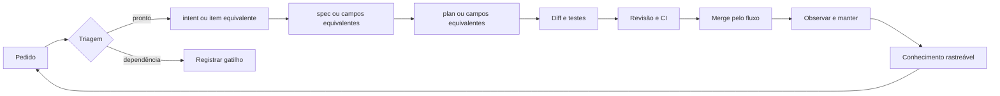
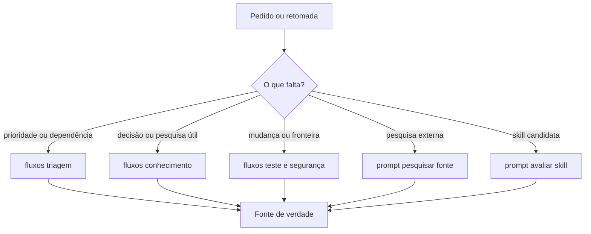
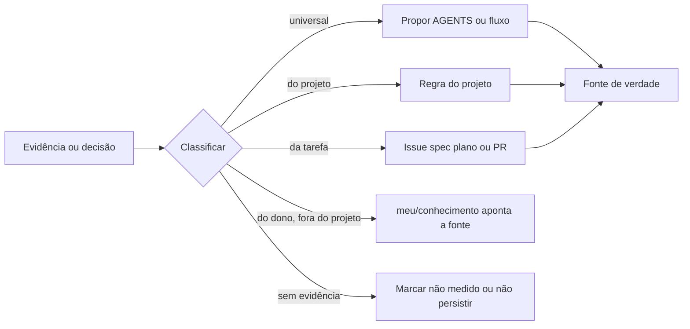
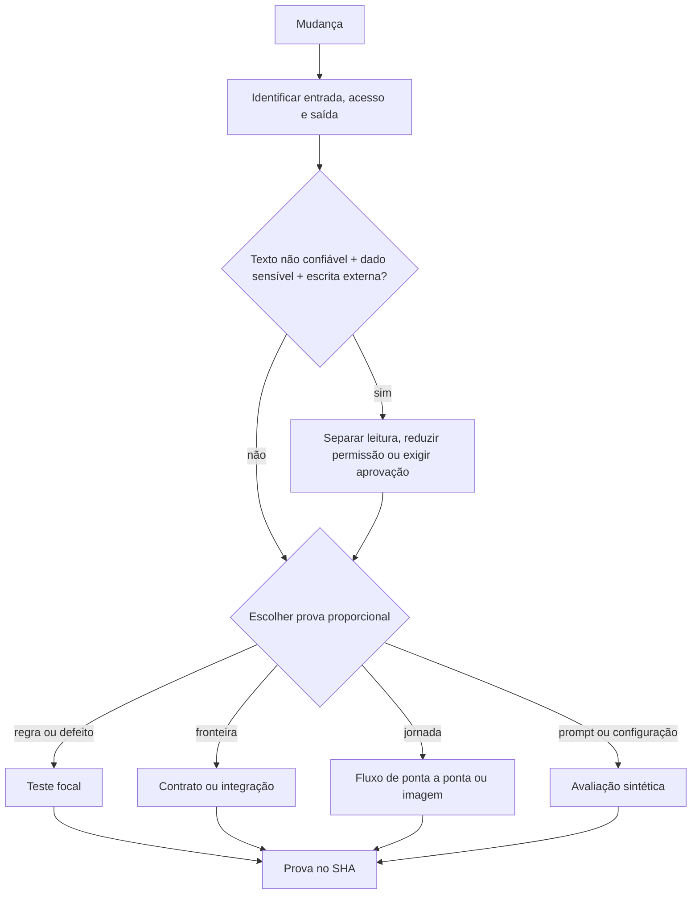
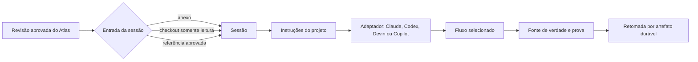

# Mapas do Atlas

Leia só o mapa que responde à tarefa. Ele resume relações; `AGENTS.md`, o fluxo aplicável, a fonte de verdade e a
prova observada prevalecem sobre qualquer desenho.

## Ciclo de entrega

## Roteamento

## Conhecimento

## Risco e prova

## Local e nuvem

